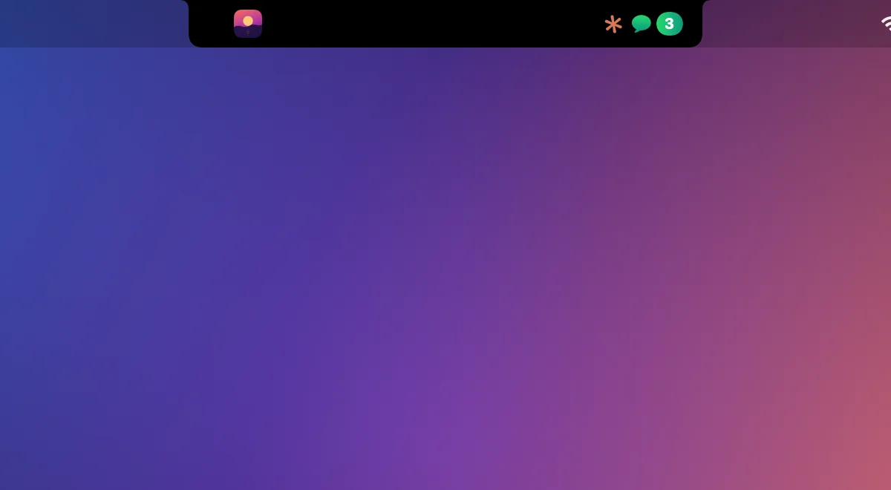
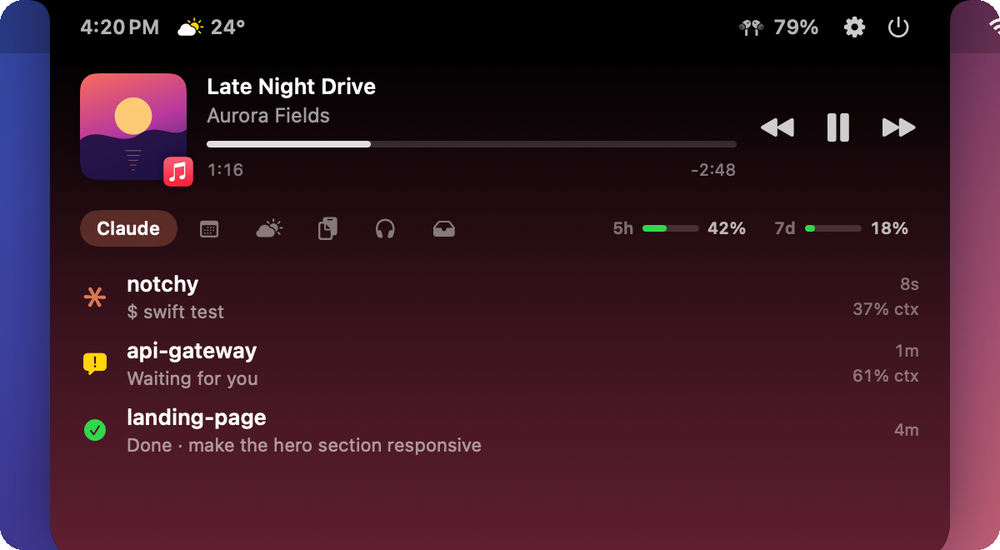
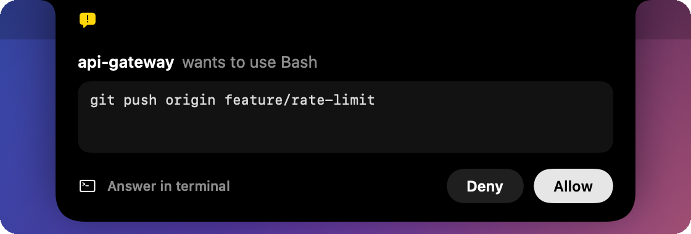
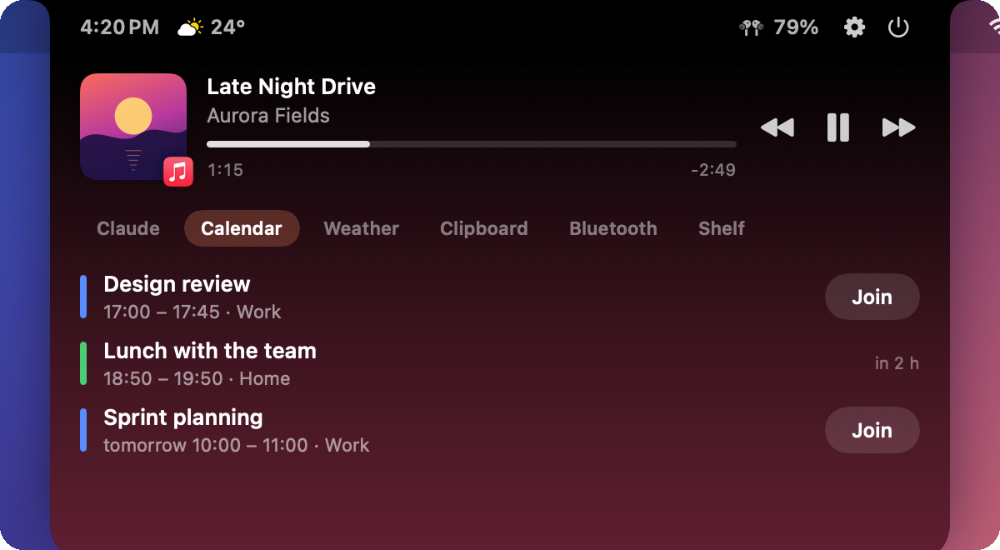
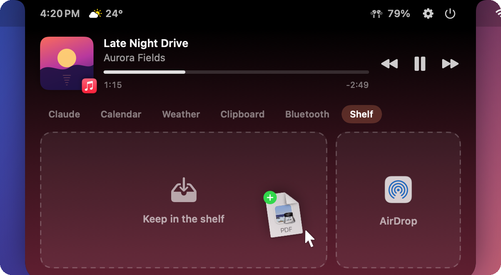
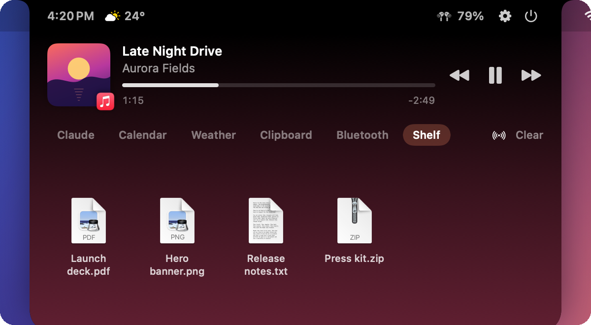
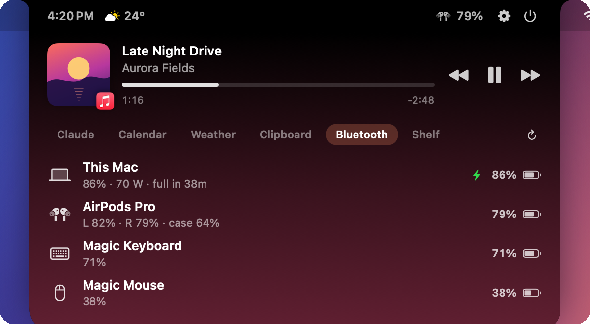
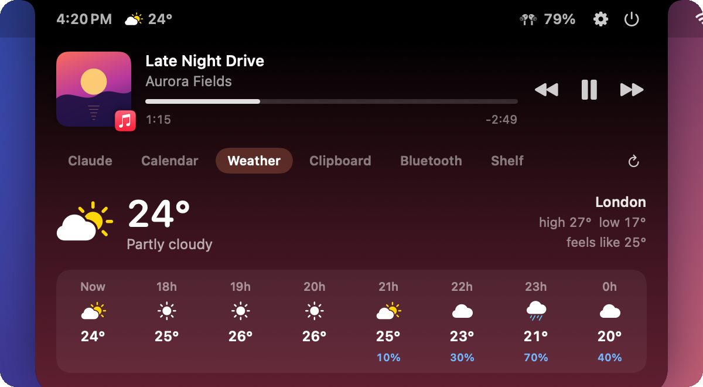
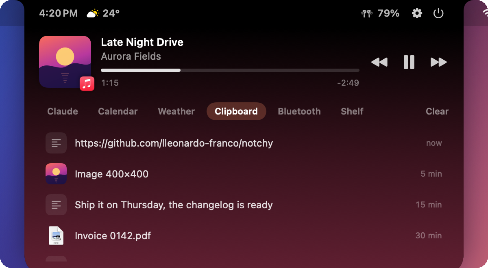
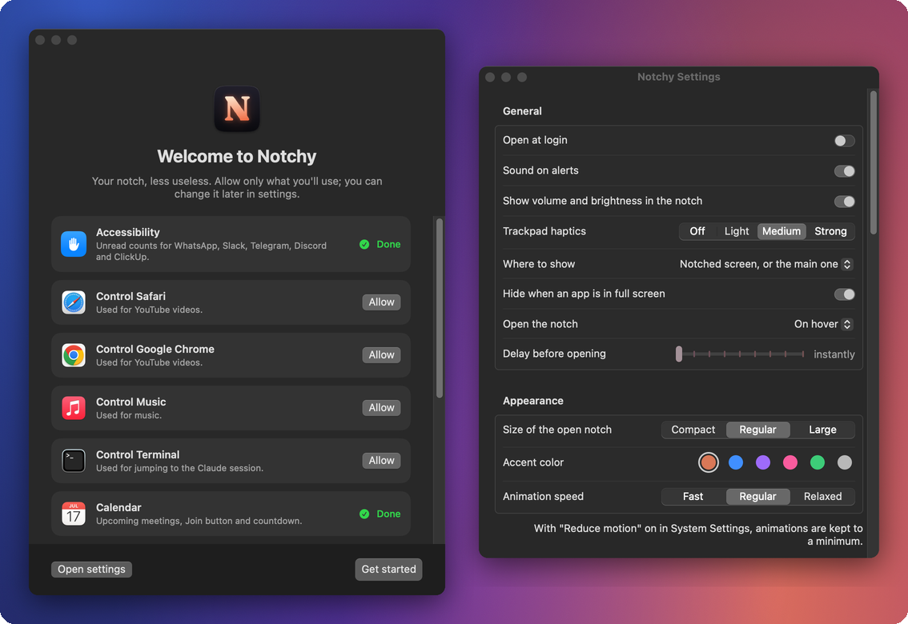

<div align="center">


# Notchy

**Your MacBook notch, finally useful.**<br>
Music, Claude Code, calendar, YouTube and notifications, right where the camera lives.

[](https://github.com/lleonardo-franco/notchy/releases)
[](https://github.com/lleonardo-franco/notchy/actions/workflows/build.yml)
[](#requirements)
[](Package.swift)
[](LICENSE)
[](CONTRIBUTING.md)

**English** · [Português](README.pt-BR.md) · [Español](README.es.md)

<br>



</div>

---

Notchy turns the notch into a tiny control center. Collapsed, it shows only what matters on each side of the camera: album art, your Claude Code status, a countdown to the next meeting, unread badges. Hover it and it opens into a player with tabs and controls. Close it and it powers off like an old CRT. The interface speaks English, Portuguese and Spanish, following your Mac's language.

## Contents

- [Take the tour](#take-the-tour)
- [Features](#features)
- [Requirements](#requirements)
- [Install](#install)
- [Usage](#usage)
- [Permissions](#permissions)
- [How it works](#how-it-works)
- [FAQ](#faq)
- [Roadmap](#roadmap)
- [Contributing](#contributing)
- [License](#license)

## Take the tour

Nine moments from a normal day with Notchy. Hover the notch and everything below is one glance away; move the mouse off and it gets out of your way.

### Quiet until you need it

Collapsed, Notchy stays on both sides of the camera and shows only what deserves your attention: the album art on the left, your Claude Code status and unread counts on the right. The rest of the menu bar stays exactly as it was.

<p align="center"></p>

### Hover, and it opens

The notch unfolds into a full player with artwork, scrubbing and controls, tinted with the colors of the album cover. Below it, tabs for everything else. When the tabs don't fit, they turn into icons so nothing gets cut off.

<p align="center"></p>

### Claude Code, without switching windows

Every session shows what it is doing right now, how long ago it last moved and how much context it has used, next to your 5‑hour and 7‑day quota. When Claude asks to run a command, the notch drops down with the exact command so you can **allow or deny it without leaving what you are doing**, or jump straight to the right terminal tab. When a task finishes, you hear about it.

<p align="center"></p>

<p align="center"></p>

### Never late for a meeting

Your next events at a glance, with a **Join** button for Zoom, Meet, Teams and Webex. A few minutes before each meeting, the collapsed notch starts a countdown.

<table>
  <tr>
    <td width="50%" align="center"></td>
    <td width="50%" align="center"></td>
  </tr>
</table>

### Drop it on the notch

Drag any file to the top of the screen and the notch opens two drop zones: keep it in the shelf for later, or send it with AirDrop on the spot. Drag it back out whenever you need it.

<table>
  <tr>
    <td width="50%" align="center"></td>
    <td width="50%" align="center"></td>
  </tr>
</table>

### Everything with a battery

Your Mac, AirPods (left, right and case), keyboard and mouse in one list. Plug in the charger or connect your headphones and the notch tells you the level, wattage and time to full.

<p align="center"></p>

<table>
  <tr>
    <td width="50%" align="center"></td>
    <td width="50%" align="center"></td>
  </tr>
</table>

### The keys you already press

Volume and brightness keys show their level right in the notch instead of the big macOS overlay in the middle of your screen. Hold Shift and Option for fine steps.

<table>
  <tr>
    <td width="50%" align="center"></td>
    <td width="50%" align="center"></td>
  </tr>
</table>

### Weather and clipboard, one glance away

The temperature sits next to the clock, with an hourly forecast and chance of rain one click away. Clipboard keeps the last things you copied, text, images and files, in memory only.

<table>
  <tr>
    <td width="50%" align="center"></td>
    <td width="50%" align="center"></td>
  </tr>
</table>

### Yours to tune

A welcome window asks only for the permissions you want, one at a time. Settings let you pick the size of the open notch, the accent color, animation speed, gestures, haptics and which tabs to show.

<p align="center"></p>

<sub>Screenshots are drawn by Notchy's own SwiftUI views with sample data, in each of the three languages, by the <a href=".github/workflows/screenshots.yml">Screenshots workflow</a>. Songs, projects and events are fictional.</sub>

## Features

<table>
  <tr>
    <td width="50%" valign="top">
      <h3>🎵 Music</h3>
      Spotify and Apple Music with artwork, title and controls, plus other apps (browsers, Podcasts, VLC…) on macOS versions that let third-party apps read Now Playing. Drag the progress bar to seek. The notch picks up a tint from the album cover.
    </td>
    <td width="50%" valign="top">
      <h3>🤖 Claude Code</h3>
      Live status of every session. <b>Approve or deny permission requests from the notch</b>, jump to the right Terminal or iTerm tab, and keep an eye on your 5‑hour and 7‑day quota.
    </td>
  </tr>
  <tr>
    <td valign="top">
      <h3>▶️ YouTube in the notch</h3>
      Playing a video in Safari, Chrome, Brave, Edge or Chromium? Send it to a mini player under the notch. It resumes at the same second and speed, and hands back to the tab when you are done.
    </td>
    <td valign="top">
      <h3>📅 Calendar</h3>
      Upcoming events with a <b>Join</b> button for Zoom, Meet, Teams and Webex, plus a countdown in the collapsed notch before each meeting.
    </td>
  </tr>
  <tr>
    <td valign="top">
      <h3>🔔 Notifications</h3>
      Animated unread counters for WhatsApp, Slack, Telegram, Discord and ClickUp, shown with each app's own icon.
    </td>
    <td valign="top">
      <h3>🗂️ Shelf and AirDrop</h3>
      Drag files onto the notch to keep them at hand, drag them out later, or drop them on AirDrop to send them right away.
    </td>
  </tr>
  <tr>
    <td valign="top">
      <h3>🎧 Bluetooth</h3>
      Battery for headphones and other devices, AirPods left, right and case included, with low‑battery alerts.
    </td>
    <td valign="top">
      <h3>🔋 Mac battery</h3>
      An alert when you plug in or unplug the charger, with the level, charger wattage and time to full or time left, plus low‑battery warnings.
    </td>
  </tr>
  <tr>
    <td valign="top">
      <h3>🌤️ Weather and clipboard</h3>
      Temperature next to the clock with an hourly forecast (Open‑Meteo), and the last 30 things you copied, kept in memory only.
    </td>
    <td valign="top">
      <h3>✋ Gestures and haptics</h3>
      Two‑finger swipes change tracks and volume, and the volume and brightness keys show their level in the notch instead of the macOS display. Trackpad haptics with adjustable strength, and a touchpad‑shaped area to try them out.
    </td>
  </tr>
</table>

## Requirements

- A Mac with macOS 14 Sonoma or later. Macs without a notch work too, using a virtual notch on the main screen.
- Xcode 16 or later, or its Command Line Tools: `xcode-select --install`
- Python 3, which ships with the Command Line Tools
- [Claude Code](https://docs.claude.com/en/docs/claude-code) is optional and only needed for the Claude tab

## Install

```bash
git clone https://github.com/lleonardo-franco/notchy.git ~/Projects/notchy
cd ~/Projects/notchy
./install.sh
```

The installer builds the app, copies it to `/Applications`, wires up the Claude Code hooks and installs the `notchy` command. The first run also:

1. creates a local code signing certificate, **Notchy Local Signing**, and asks for your Mac password once to trust it;
2. opens a welcome window where you grant only the permissions you want.

Because every build is signed with the same certificate, macOS keeps your permissions across updates, and later runs only rebuild what changed.

**Update** with `notchy update`, or from Settings → About when Notchy tells you a new version is out. **Remove everything** with `notchy uninstall`.

### With Homebrew

```bash
brew tap lleonardo-franco/notchy https://github.com/lleonardo-franco/notchy
brew install notchy
notchy setup
```

`notchy setup` builds the app and installs it in `/Applications`, just like `./install.sh`. After `brew upgrade notchy`, run `notchy setup` again (or simply `notchy update`, which does both).

## Usage

| Command | What it does |
|---|---|
| `notchy` | Start |
| `notchy stop` / `restart` | Quit with the power‑off animation / restart |
| `notchy settings` | Open settings |
| `notchy welcome` | Show the welcome and permissions window |
| `notchy city "Lisbon"` | Set the weather city (`notchy city auto` to go back to automatic) |
| `notchy doctor` | Check signature, certificate and permissions |
| `notchy update` | Pull the latest version and reinstall |
| `notchy uninstall` | Remove the app, hooks, settings and command |

The installer and the command follow your Mac's language. Set `NOTCHY_LANG=en`, `pt` or `es` to choose one.

| Gesture on the open notch | Action |
|---|---|
| Two fingers right / left | Next / previous track (configurable) |
| Two fingers up / down | Volume |
| Two fingers sideways on a video | Skip ±10 s |

## Permissions

Everything is opt‑in. Notchy works with any subset of these.

| Permission | Used for |
|---|---|
| Accessibility | Reading unread counts (WhatsApp, Slack, Telegram, Discord, ClickUp) from the Dock, and showing the volume and brightness keys in the notch |
| Automation: Safari, Chrome | Finding YouTube videos, pausing the tab and resuming at the same spot |
| Automation: Spotify, Music | Showing and controlling playback |
| Automation: Terminal, iTerm | Jumping to the right Claude Code session |
| Calendars | Upcoming meetings |
| Bluetooth | Device battery levels |

> [!TIP]
> To resume videos at the exact second, enable **Allow JavaScript from Apple Events** in the browser's Develop menu. In Safari, turn on the Develop menu in Settings → Advanced → Show features for web developers.

## How it works

<details>
<summary>Architecture overview</summary>

<br>

| Piece | How |
|---|---|
| Window | An `NSPanel` above the menu bar, positioned from the notched screen's `safeAreaInsets` |
| Music | Distributed notifications from Spotify and Music, plus AppleScript |
| Claude Code | Hooks write each session's state to `~/.notchy/sessions`; the `PermissionRequest` hook waits for the notch's answer; a status line wrapper provides the quota |
| Video | AppleScript reads browser tabs; the player is the YouTube IFrame API in a `WKWebView` |
| Notifications | Dock badge labels via the Accessibility API |
| Bluetooth | `system_profiler SPBluetoothDataType` |
| Haptics | The trackpad actuator directly, so it works while the app is in the background |
| Full screen | Detects full‑screen Spaces to hide the notch |

Periodic checks pause while the screen is locked or the Mac is asleep, and slow down while the notch is closed.

```
Sources/Notchy/   SwiftUI app, services and views
hooks/            Claude Code hooks and status line (Python, stdlib only)
bin/notchy        Command line tool
install.sh        Installer, signing and incremental updates
build.sh          Builds build/Notchy.app
```

</details>

## FAQ

<details>
<summary><b>Why does it ask for my password during the first install?</b></summary>
<br>
To trust the local signing certificate and let <code>codesign</code> use it without prompting again. It happens once. Without a stable signature, macOS would ask for every permission again after each update.
</details>

<details>
<summary><b>Does it send my data anywhere?</b></summary>
<br>
No. The only network calls are to Open‑Meteo and an IP geolocation service for the weather, to YouTube when you play a video in the notch, and to GitHub to check for new versions (can be turned off). The clipboard history lives in memory and disappears when the app quits.
</details>

<details>
<summary><b>Will it mess with my Claude Code status line?</b></summary>
<br>
No. The installer wraps your existing status line and keeps it. <code>notchy uninstall</code> restores the original.
</details>

<details>
<summary><b>Is there a prebuilt download?</b></summary>
<br>
No. Notchy is built from source on your Mac, either with `./install.sh` or with Homebrew and `notchy setup`. That way it is signed with your own local certificate and macOS keeps its permissions between updates.
</details>

## Roadmap

- [x] Interface in English, Portuguese and Spanish
- [x] Homebrew
- [x] More badge sources: Slack, Telegram, Discord
- [x] Screenshots and an animated tour in this README

Have an idea? [Open a feature request](https://github.com/lleonardo-franco/notchy/issues/new/choose).

## Contributing

Contributions of every size are welcome: bug reports, ideas, translations, docs and code. Read the [contributing guide](CONTRIBUTING.md) to learn how to fork the repo, set up the project and open a pull request. Look for issues labeled [`good first issue`](https://github.com/lleonardo-franco/notchy/labels/good%20first%20issue) to get started.

Everyone taking part is expected to follow the [Code of Conduct](CODE_OF_CONDUCT.md). Found a security problem? See [SECURITY.md](SECURITY.md).

## License

[MIT](LICENSE) © Leonardo Franco Lima

<div align="center">
<sub>If Notchy made your notch a little less useless, consider giving it a ⭐</sub>
</div>
