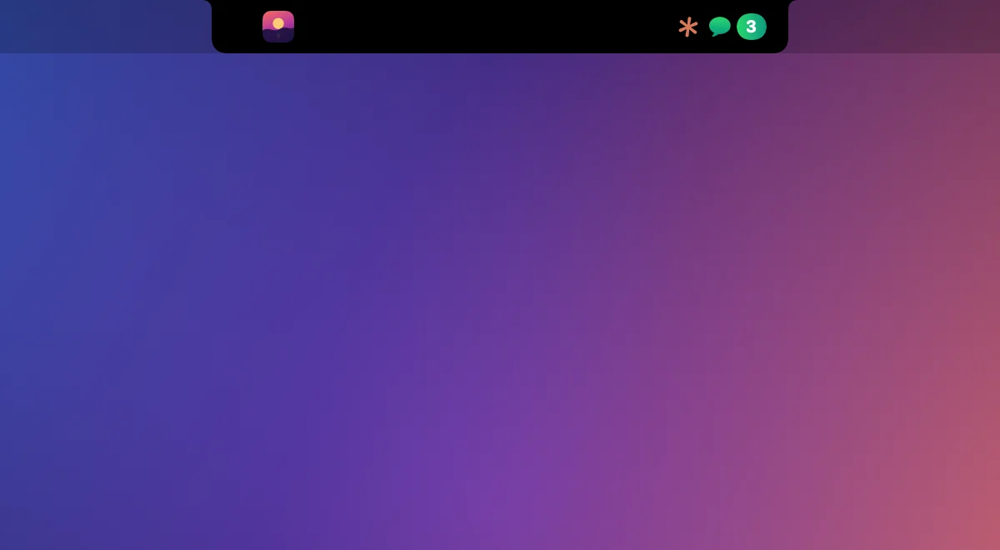
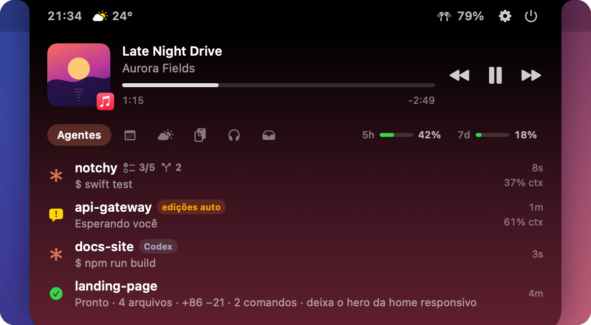
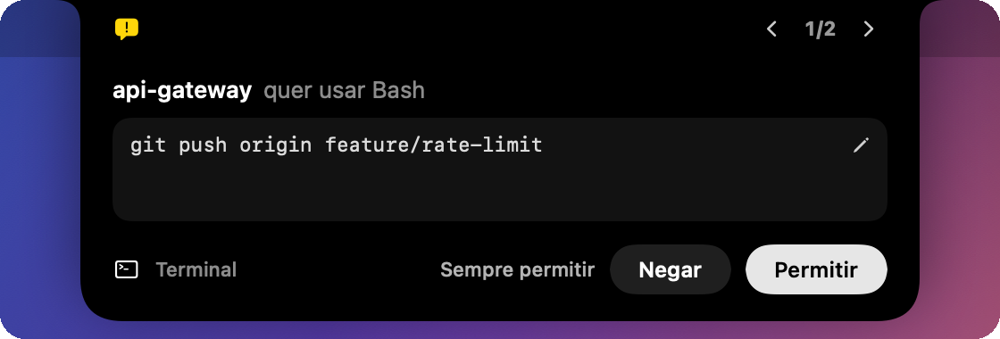
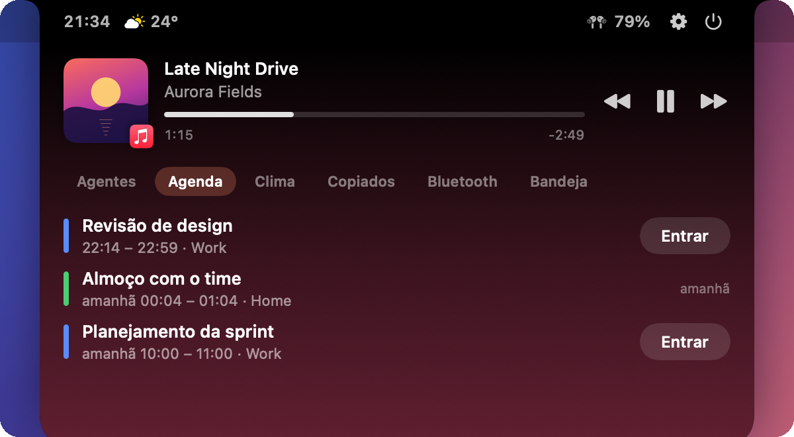
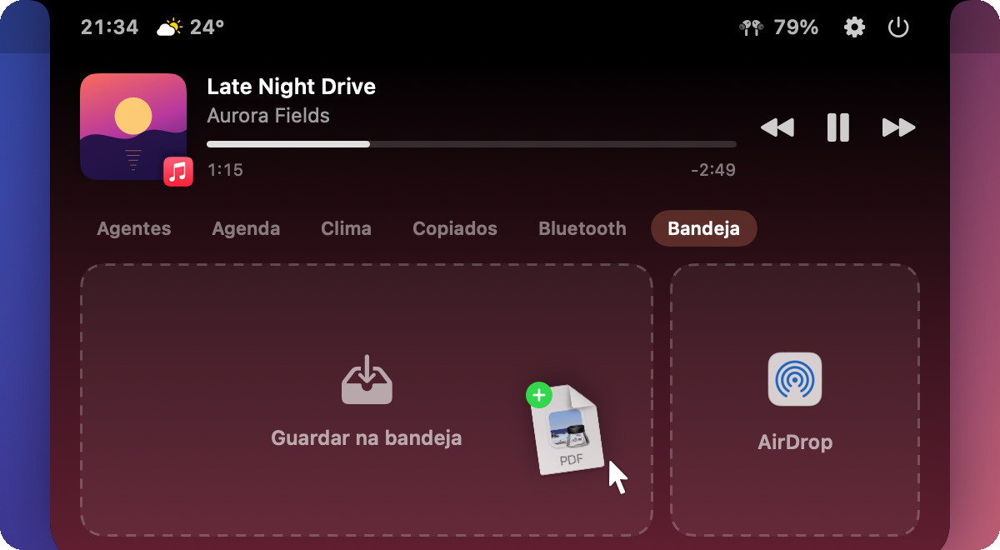
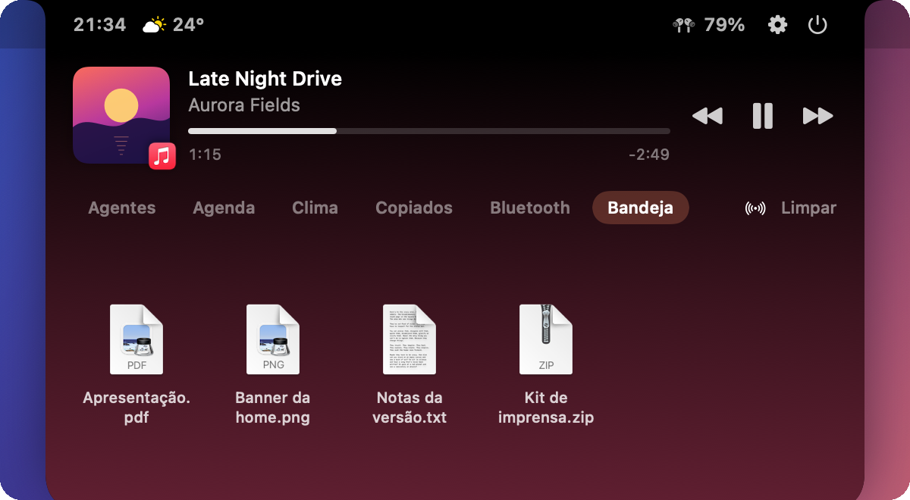
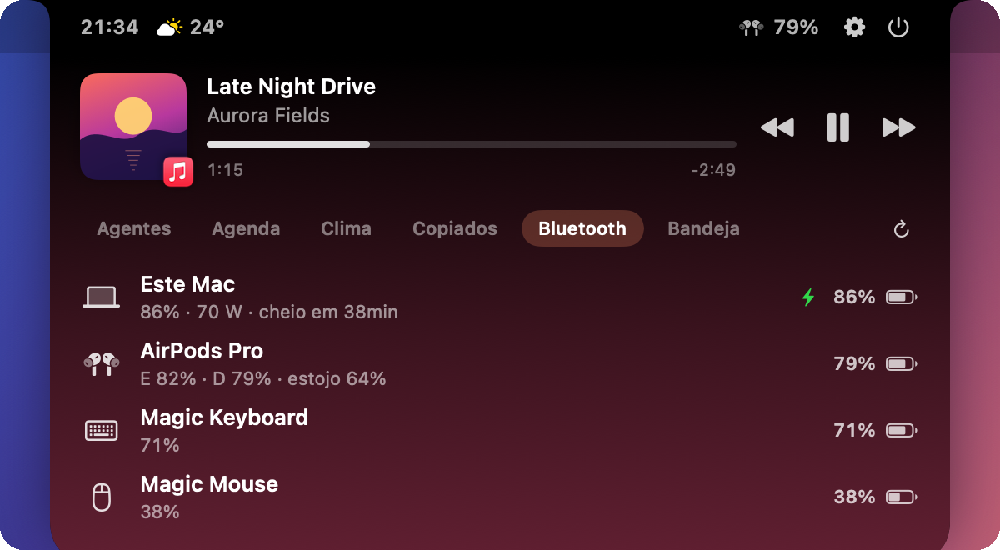
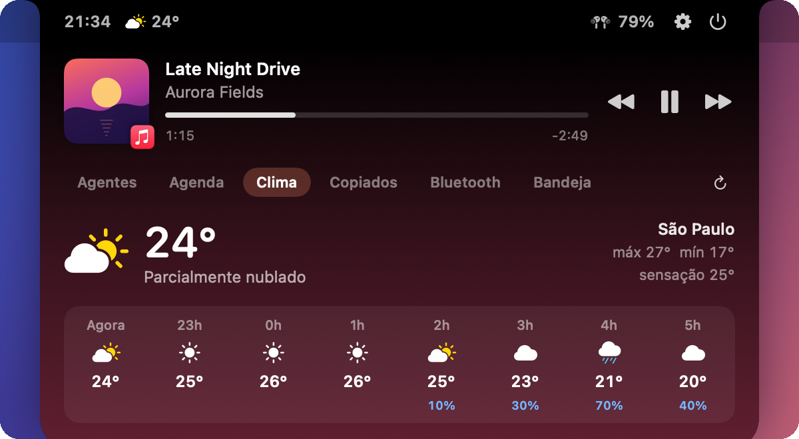
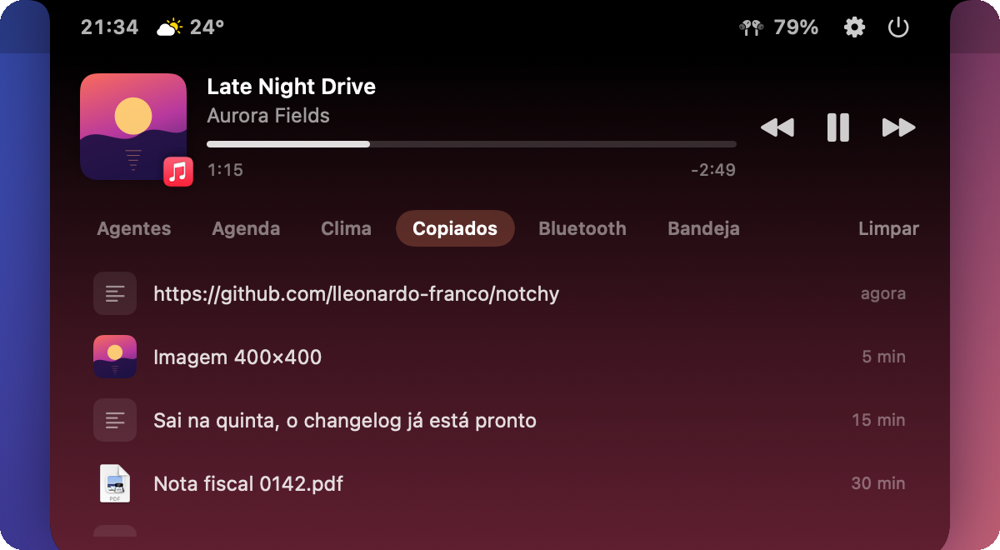
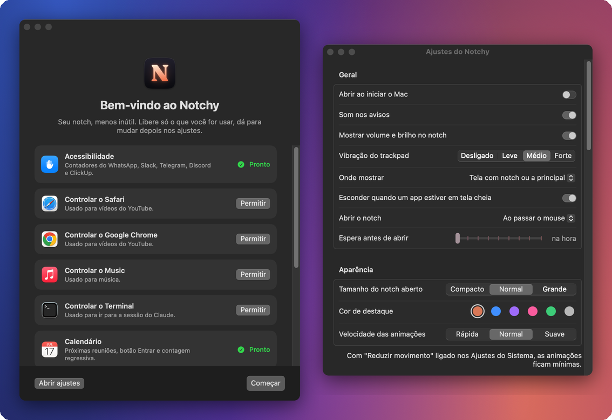

<div align="center">


# Notchy

**O notch do seu MacBook, finalmente útil.**<br>
Música, Claude Code e outros agentes de código, agenda, YouTube e notificações bem onde fica a câmera.

[](https://github.com/lleonardo-franco/notchy/releases)
[](https://github.com/lleonardo-franco/notchy/actions/workflows/build.yml)
[](#requisitos)
[](Package.swift)
[](LICENSE)
[](CONTRIBUTING.pt-BR.md)

[English](README.md) · **Português** · [Español](README.es.md)

<br>



</div>

---

O Notchy transforma o notch numa pequena central. Recolhido, ele mostra só o que importa dos lados da câmera: a capa da música, o status do Claude Code, a contagem para a próxima reunião, notificações. Passe o mouse e ele abre com o player, abas e controles. Feche e ele desliga como uma TV antiga. A interface fala português, inglês e espanhol, seguindo o idioma do seu Mac.

## Sumário

- [Faça o tour](#faça-o-tour)
- [Funcionalidades](#funcionalidades)
- [Requisitos](#requisitos)
- [Instalação](#instalação)
- [Uso](#uso)
- [Permissões](#permissões)
- [Como funciona](#como-funciona)
- [Perguntas frequentes](#perguntas-frequentes)
- [Roadmap](#roadmap)
- [Contribuindo](#contribuindo)
- [Licença](#licença)

## Faça o tour

Nove momentos de um dia normal com o Notchy. Passe o mouse no notch e tudo isso fica a um olhar de distância; tire o mouse e ele sai da frente.

### Discreto até você precisar

Recolhido, o Notchy fica dos dois lados da câmera e mostra só o que merece sua atenção: a capa da música à esquerda, o status do Claude Code e as notificações à direita. O resto da barra de menus continua igualzinho.

<p align="center"></p>

### Passe o mouse e ele abre

O notch se abre num player completo, com capa, barra de progresso e controles, tingido com as cores da capa do álbum. Embaixo, abas para todo o resto. Quando as abas não cabem, viram ícones para nada ficar cortado.

<p align="center"></p>

### Seus agentes de código sem trocar de janela

Sessões do Claude Code, Codex, Gemini, Copilot e Cursor lado a lado. Cada uma mostra o que está fazendo agora, o progresso da lista de tarefas, os subagentes rodando, se está em modo de planejamento ou rodando sem pedir permissão e quanto do contexto já usou, ao lado da sua cota de 5 horas e de 7 dias e de uma previsão de quando ela acaba no ritmo atual. Quando um agente pede para rodar um comando, o notch desce com o comando exato para você **permitir ou negar sem largar o que está fazendo**, editar antes, mandar o Notchy sempre permitir naquele projeto ou pular direto para a aba certa do terminal. Vários pedidos ao mesmo tempo? Passe de um para o outro. Quando uma tarefa termina, vem um resumo de arquivos, linhas e comandos; quando falha, você vê o motivo.

<p align="center"></p>

<p align="center"></p>

### Nunca mais atrasado para reunião

Seus próximos eventos num relance, com o botão **Entrar** para Zoom, Meet, Teams e Webex. Alguns minutos antes de cada reunião, o notch recolhido começa uma contagem regressiva.

<table>
  <tr>
    <td width="50%" align="center"></td>
    <td width="50%" align="center"></td>
  </tr>
</table>

### Solte no notch

Arraste qualquer arquivo para o topo da tela e o notch abre duas áreas: guarde na bandeja para depois ou mande por AirDrop na hora. Arraste de volta para fora quando precisar.

<table>
  <tr>
    <td width="50%" align="center"></td>
    <td width="50%" align="center"></td>
  </tr>
</table>

### Tudo que tem bateria

Seu Mac, AirPods (esquerdo, direito e estojo), teclado e mouse numa lista só. Ligue o carregador ou conecte os fones e o notch mostra o nível, a potência e quanto falta para carregar.

<p align="center"></p>

<table>
  <tr>
    <td width="50%" align="center"></td>
    <td width="50%" align="center"></td>
  </tr>
</table>

### As teclas que você já usa

As teclas de volume e brilho mostram o nível no próprio notch, em vez do aviso grande do macOS no meio da tela. Segure Shift e Option para ajustes finos.

<table>
  <tr>
    <td width="50%" align="center"></td>
    <td width="50%" align="center"></td>
  </tr>
</table>

### Clima e copiados a um olhar

A temperatura fica ao lado do relógio, com a previsão hora a hora e a chance de chuva a um clique. Copiados guarda as últimas coisas que você copiou, textos, imagens e arquivos, só na memória.

<table>
  <tr>
    <td width="50%" align="center"></td>
    <td width="50%" align="center"></td>
  </tr>
</table>

### Do seu jeito

A janela de boas‑vindas pede só as permissões que você quiser, uma de cada vez. Nos ajustes você escolhe o tamanho do notch aberto, a cor de destaque, a velocidade das animações, os gestos, a vibração e quais abas aparecem.

<p align="center"></p>

<sub>As imagens são desenhadas pelas próprias views SwiftUI do Notchy com dados de exemplo, nos três idiomas, pelo <a href=".github/workflows/screenshots.yml">workflow Screenshots</a>. Músicas, projetos e eventos são fictícios.</sub>

## Funcionalidades

<table>
  <tr>
    <td width="50%" valign="top">
      <h3>🎵 Música</h3>
      Spotify e Apple Music com capa, título e controles, e também outros apps (navegador, Podcasts, VLC…) nas versões do macOS que liberam o "Tocando agora" para outros apps. Arraste a barra de progresso para pular trechos. O notch ganha um tom da cor da capa.
    </td>
    <td width="50%" valign="top">
      <h3>🤖 Claude Code e outros agentes</h3>
      Status em tempo real das sessões do Claude Code, Codex, Gemini, Copilot e Cursor, com tarefas, subagentes e um resumo ao terminar. <b>Aprove, edite ou sempre permita comandos pelo notch</b>, pule para a aba certa do terminal e veja a cota com previsão.
    </td>
  </tr>
  <tr>
    <td valign="top">
      <h3>▶️ YouTube no notch</h3>
      Tem um vídeo tocando no Safari, Chrome, Brave, Edge ou Chromium? Mande para um mini player embaixo do notch. Ele continua do mesmo segundo e na mesma velocidade, e devolve para a aba quando você terminar.
    </td>
    <td valign="top">
      <h3>📅 Agenda</h3>
      Próximos compromissos com botão <b>Entrar</b> para Zoom, Meet, Teams e Webex, e contagem regressiva no notch recolhido antes de cada reunião.
    </td>
  </tr>
  <tr>
    <td valign="top">
      <h3>🔔 Notificações</h3>
      Contadores animados do WhatsApp, Slack, Telegram, Discord e ClickUp, com o ícone de cada app.
    </td>
    <td valign="top">
      <h3>🗂️ Bandeja e AirDrop</h3>
      Arraste arquivos até o notch para deixá-los à mão, arraste de volta quando precisar, ou solte no AirDrop para enviar na hora.
    </td>
  </tr>
  <tr>
    <td valign="top">
      <h3>🎧 Bluetooth</h3>
      Bateria dos fones e de outros dispositivos, incluindo AirPods esquerdo, direito e estojo, com aviso de bateria baixa.
    </td>
    <td valign="top">
      <h3>🔋 Bateria do Mac</h3>
      Aviso ao conectar ou tirar o carregador, com o nível, a potência do carregador e o tempo até encher ou o tempo restante, além de alerta de bateria baixa.
    </td>
  </tr>
  <tr>
    <td valign="top">
      <h3>🌤️ Clima e copiados</h3>
      Temperatura ao lado do relógio com previsão por hora (Open‑Meteo), e os últimos 30 itens copiados, guardados só na memória.
    </td>
    <td valign="top">
      <h3>✋ Gestos e vibração</h3>
      Dois dedos trocam de música e mudam o volume, e as teclas de volume e brilho mostram o nível no notch no lugar do aviso do macOS. Vibração no trackpad com intensidade ajustável e uma área em forma de touchpad para testar.
    </td>
  </tr>
</table>

## Requisitos

- Mac com macOS 14 Sonoma ou mais novo. Macs sem notch também funcionam, com o painel na tela principal.
- Xcode 16 ou mais novo, ou as ferramentas de linha de comando dele: `xcode-select --install`
- Python 3, que vem com elas
- [Claude Code](https://docs.claude.com/en/docs/claude-code) ou outro agente de código é opcional e só serve para a aba Agentes

## Instalação

```bash
git clone https://github.com/lleonardo-franco/notchy.git ~/Projects/notchy
cd ~/Projects/notchy
./install.sh
```

O instalador compila o app, copia para `/Applications`, conecta os hooks do Claude Code e instala o comando `notchy`. Na primeira vez ele também:

1. cria um certificado local de assinatura, **Notchy Local Signing**, e pede a senha do Mac uma vez para confiar nele;
2. abre a janela de boas-vindas, onde você libera só as permissões que quiser.

Como toda versão é assinada com o mesmo certificado, o macOS mantém as permissões entre as atualizações, e as próximas instalações só refazem o que mudou.

**Atualize** com `notchy update`, ou em Ajustes → Sobre quando o Notchy avisar que saiu uma versão nova. **Remova tudo** com `notchy uninstall`.

### Com o Homebrew

```bash
brew tap lleonardo-franco/notchy https://github.com/lleonardo-franco/notchy
brew install notchy
notchy setup
```

O `notchy setup` compila o app e instala em `/Applications`, igual ao `./install.sh`. Depois de um `brew upgrade notchy`, rode `notchy setup` de novo (ou só `notchy update`, que faz os dois).

## Uso

| Comando | O que faz |
|---|---|
| `notchy` | Abre |
| `notchy stop` / `restart` | Fecha com a animação de desligar / reinicia |
| `notchy settings` | Abre os ajustes |
| `notchy welcome` | Mostra as boas-vindas e as permissões |
| `notchy city "Farroupilha"` | Define a cidade do clima (`notchy city auto` volta ao automático) |
| `notchy doctor` | Confere assinatura, certificado e permissões |
| `notchy update` | Baixa a versão mais nova e reinstala |
| `notchy agents` | Conecta ou desconecta Codex, Gemini, Copilot e Cursor (veja abaixo) |
| `notchy uninstall` | Remove app, hooks, ajustes e o comando |

O instalador e o comando seguem o idioma do seu Mac. Use `NOTCHY_LANG=pt`, `en` ou `es` para escolher um.

| Gesto com o notch aberto | Ação |
|---|---|
| Dois dedos para a direita / esquerda | Próxima / anterior (configurável) |
| Dois dedos para cima / baixo | Volume |
| Dois dedos para os lados num vídeo | Avança ou volta 10 s |

### Agentes de código

O Claude Code é conectado pelo instalador. Os outros agentes estão a um comando de distância, ou a um botão em Ajustes → Agentes de código:

```bash
notchy agents                      # o que está conectado
notchy agents enable codex gemini  # conecta um ou mais
notchy agents enable cursor --approvals
notchy agents disable copilot
```

| Agente | Status no notch | Aprovar pelo notch |
|---|---|---|
| Claude Code | ✅ | ✅ inclusive editar o comando e "Sempre permitir" |
| GitHub Copilot CLI | ✅ | ✅ |
| Cursor (agente) | ✅ | ✅ opcional com `--approvals`, para comandos de terminal e MCP |
| Codex CLI | ✅ | — os hooks do Codex só bloqueiam, não liberam |
| Gemini CLI | ✅ | — |

O sistema de hooks de cada agente é novo e muda com frequência, então o suporte a tudo que não é o Claude Code é experimental. Se algo parar de funcionar depois de atualizar um agente, [abra uma issue](https://github.com/lleonardo-franco/notchy/issues/new/choose).

## Permissões

Tudo é opcional. O Notchy funciona com qualquer combinação delas.

| Permissão | Para quê |
|---|---|
| Acessibilidade | Ler os contadores (WhatsApp, Slack, Telegram, Discord, ClickUp) no Dock e mostrar as teclas de volume e brilho no notch |
| Automação: Safari, Chrome | Encontrar vídeos do YouTube, pausar a aba e continuar no mesmo ponto |
| Automação: Spotify, Music | Mostrar e controlar a música |
| Automação: Terminal, iTerm | Ir até a sessão certa do Claude Code |
| Calendários | Próximas reuniões |
| Bluetooth | Bateria dos dispositivos |

> [!TIP]
> Para o vídeo continuar no segundo exato, ative **Permitir JavaScript de Eventos Apple** no menu Desenvolvedor do navegador. No Safari, mostre esse menu em Ajustes → Avançado → Mostrar recursos para desenvolvedores da Web.

## Como funciona

<details>
<summary>Visão geral da arquitetura</summary>

<br>

| Parte | Como |
|---|---|
| Janela | `NSPanel` acima da barra de menus, posicionado pelo `safeAreaInsets` da tela com notch |
| Música | Notificações distribuídas do Spotify e do Music, mais AppleScript |
| Agentes de código | Um script de hook com um adaptador por agente grava o estado de cada sessão em `~/.notchy/sessions`; os hooks de permissão esperam a resposta do notch e as regras de "Sempre permitir" ficam em `~/.notchy/rules.json`; um wrapper da status line fornece a cota do Claude |
| Vídeo | AppleScript lê as abas do navegador; o player é a API de iframe do YouTube num `WKWebView` |
| Notificações | Contadores do Dock pela API de Acessibilidade |
| Bluetooth | `system_profiler SPBluetoothDataType` |
| Vibração | Motor do trackpad direto, para funcionar com o app em segundo plano |
| Tela cheia | Detecta Spaces de tela cheia para esconder o notch |

As verificações periódicas pausam com a tela bloqueada ou o Mac dormindo, e ficam mais espaçadas com o notch fechado.

```
Sources/Notchy/   app SwiftUI, serviços e views
hooks/            hooks e status line do Claude Code (Python, só biblioteca padrão)
bin/notchy        ferramenta de linha de comando
install.sh        instalador, assinatura e atualização incremental
build.sh          gera build/Notchy.app
```

</details>

## Perguntas frequentes

<details>
<summary><b>Por que pede minha senha na primeira instalação?</b></summary>
<br>
Para confiar no certificado local de assinatura e deixar o <code>codesign</code> usá-lo sem perguntar de novo. Acontece uma vez só. Sem uma assinatura estável, o macOS pediria todas as permissões de novo a cada atualização.
</details>

<details>
<summary><b>Ele manda meus dados para algum lugar?</b></summary>
<br>
Não. As únicas chamadas de rede são para o Open‑Meteo e um serviço de localização por IP, para o clima, para o YouTube quando você assiste um vídeo no notch, e para o GitHub para procurar versões novas (dá para desligar). O histórico de copiados fica na memória e some quando o app fecha.
</details>

<details>
<summary><b>Ele mexe na minha status line do Claude Code?</b></summary>
<br>
Não. O instalador envolve a status line que você já tem e mantém ela. O <code>notchy uninstall</code> devolve a original.
</details>

<details>
<summary><b>Tem um download pronto?</b></summary>
<br>
Não. O Notchy é compilado no seu Mac a partir do código, com o `./install.sh` ou com o Homebrew e o `notchy setup`. Assim ele fica assinado com o seu certificado local e o macOS mantém as permissões entre as atualizações.
</details>

## Roadmap

- [x] Interface em inglês, português e espanhol
- [x] Homebrew
- [x] Mais fontes de notificação: Slack, Telegram, Discord
- [x] Capturas de tela e um tour animado neste README

Tem uma ideia? [Sugira uma funcionalidade](https://github.com/lleonardo-franco/notchy/issues/new/choose).

## Contribuindo

Contribuições de qualquer tamanho são bem-vindas: relatos de bugs, ideias, traduções, documentação e código. Leia o [guia de contribuição](CONTRIBUTING.pt-BR.md) para ver como fazer fork do repositório, preparar o projeto e abrir um pull request. Procure issues com a etiqueta [`good first issue`](https://github.com/lleonardo-franco/notchy/labels/good%20first%20issue) para começar.

Todo mundo que participa deve seguir o [Código de Conduta](CODE_OF_CONDUCT.md). Achou um problema de segurança? Veja o [SECURITY.md](SECURITY.md).

## Licença

[MIT](LICENSE) © Leonardo Franco Lima

<div align="center">
<sub>Se o Notchy deixou seu notch um pouco menos inútil, deixe uma ⭐</sub>
</div>
